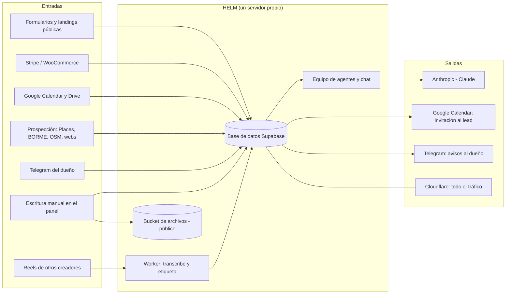

# 2. Mapa de datos personales

Qué datos de personas entran en HELM, dónde se guardan, quién los ve, cuánto duran y a quién salen.

## Diagrama

## Qué entra y dónde acaba

| Origen | Datos | Tablas | Quién puede leerlo hoy |
|---|---|---|---|
| Formularios y landings públicas | Nombre, email, teléfono, empresa, Instagram, respuestas libres, UTM, IP | `crm_contacts`, `helm_form_responses`, `crm_activities` | Ver nota ⚠ |
| Reserva de llamada desde un formulario | Lo anterior, copiado a un evento de Google Calendar con el lead como invitado | Google Calendar del perfil, `helm_calls` | Ver nota ⚠ |
| Stripe y WooCommerce | Nombre, email, teléfono del comprador, importes | `sales`, `crm_contacts`, `crm_activities`, `ceo_finance_entries` | Ver nota ⚠ |
| Google Calendar | Asistentes (nombre, email), descripción, enlace de Meet | `helm_calls` | Ver nota ⚠ |
| Prospección | Empresas y **personas**: administradores (BORME), titular del aviso legal, nombres y cargos de la web, emails, teléfonos | `helm_prospects` → `crm_contacts` | Ver nota ⚠ |
| Chat y Telegram | Lo que escribe el dueño, incluidas conversaciones de leads que pega | `helm_chat_messages`, `helm_knowledge` | Ver nota ⚠ |
| Biblioteca y Drive | Documentos y transcripciones de llamadas ligadas a un contacto | `helm_library` | Ver nota ⚠ |
| Archivos, facturas y portal fiscal | Documentos subidos por el perfil o por sus clientes | bucket `helm` + `helm_files`, `helm_fiscal_documentos` | Cualquiera con el enlace (bucket público) |
| Equipo | Nombre, email, teléfono, comisión, fijo, notas; métricas diarias por persona | `helm_team`, `team`, `reports` | `team` solo servidor; el resto ver nota ⚠ |
| «Mi día» | Texto libre del usuario (p. ej. un correo pegado) y la respuesta de la IA | `helm_dia` | Solo el servidor, filtrado por autor |
| Mesa de edición | Clientes del editor, pedidos, cobros | `helm_edicion_*` | Solo el servidor |
| Reels de otros creadores | Su voz transcrita, su usuario, sus métricas públicas | `agent_reels`, `agent_memory` | Solo el servidor (y el conector MCP) |
| Vídeos propios en Drive | Voz e imagen de quien sale; transcripción de los primeros 4 minutos | `agent_drive_videos` | Solo el servidor (y el conector MCP) |
| Registro de auditoría | Email del actor, IP, navegador | `audit_logs` | Ver nota ⚠ |

**Nota ⚠ — el punto más grave de la auditoría.** En teoría esos datos solo los ve el equipo del perfil y el superadmin. En la práctica, hoy los puede leer y modificar **cualquier persona desde internet**, sin iniciar sesión, porque la base está expuesta con una clave pública y sin reglas de acceso reales. Está explicado y comprobado en `04-seguridad.md` (riesgo n.º 1).

Volumen actual (5 oct 2026): 9 perfiles, 99 contactos, 95 respuestas de formulario, 15 ventas, 208 entradas de auditoría, 13 cuentas de acceso.

## Consentimiento

- `/empresas` y `/primermap` tienen casilla obligatoria, pero **no se guarda** que se marcó, ni cuándo, ni qué texto se aceptó.
- El formulario público propio (`/f/:id`) y `api/formularios.js` no recogen consentimiento.
- La política de privacidad (`src/pages/inicio/socio/Legal.jsx`) tiene sin rellenar el NIF del responsable, la dirección, el email de contacto y los proveedores.
- No hay banner de cookies. Tampoco hay píxeles cargados en el código (solo Google Fonts), así que hoy no hace falta; hará falta en cuanto se añada uno.

## Conservación y borrado

- **No hay plazos de conservación ni borrado automático** de ningún dato personal.
- Lo único que caduca: las copias de la base (14 días) y los audios temporales (se borran al transcribir; si el trabajo falla, se quedan: hoy hay 5).
- Borrar un perfil (solo superadmin) borra sus filas y archivos, pero antes guarda una copia completa en `~/helm-copias/` que **nunca se borra** (incluye hashes de contraseña y tokens). Tampoco borra los archivos del portal fiscal (`fiscal/<perfil>/…`), ni lo que ya esté en copias de la base, ni los eventos creados en Google Calendar.
- No existe «descargar mis datos» ni «borrar mis datos» para una persona concreta (un lead, un alumno). Solo hay una exportación CSV del CRM para uso interno.
